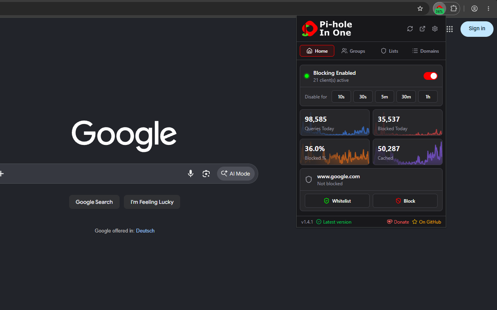
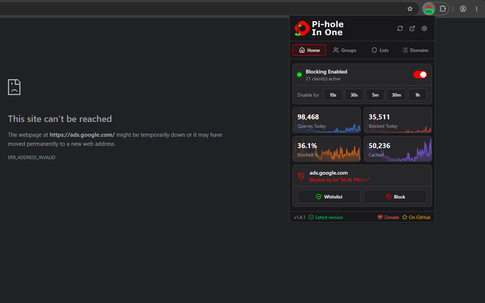
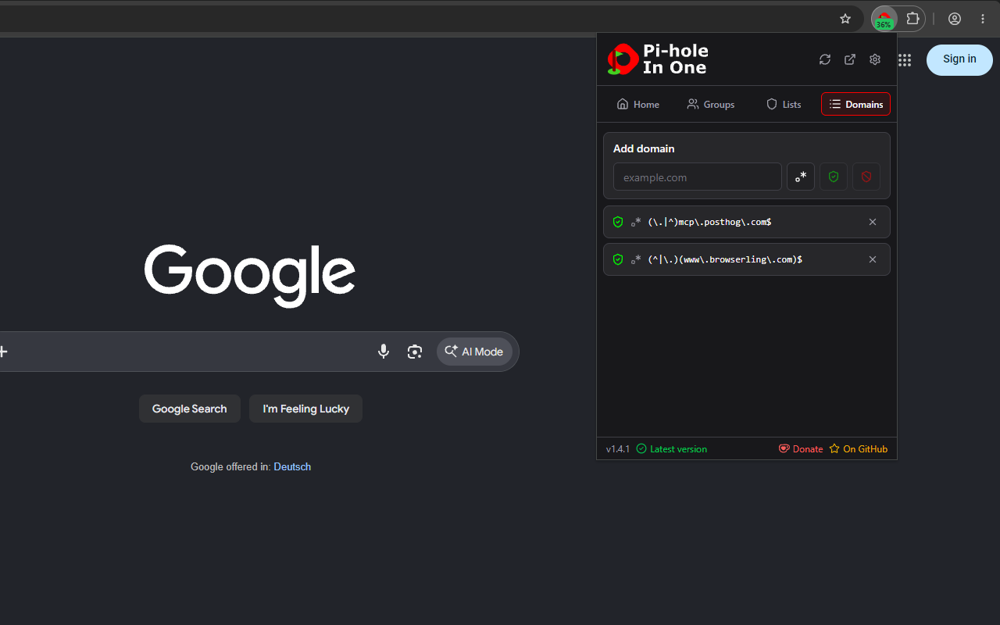
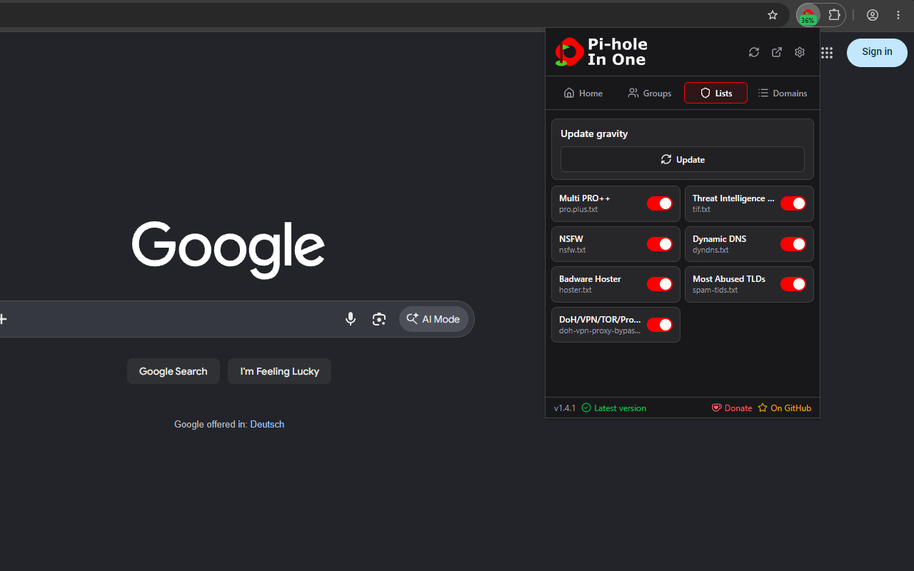
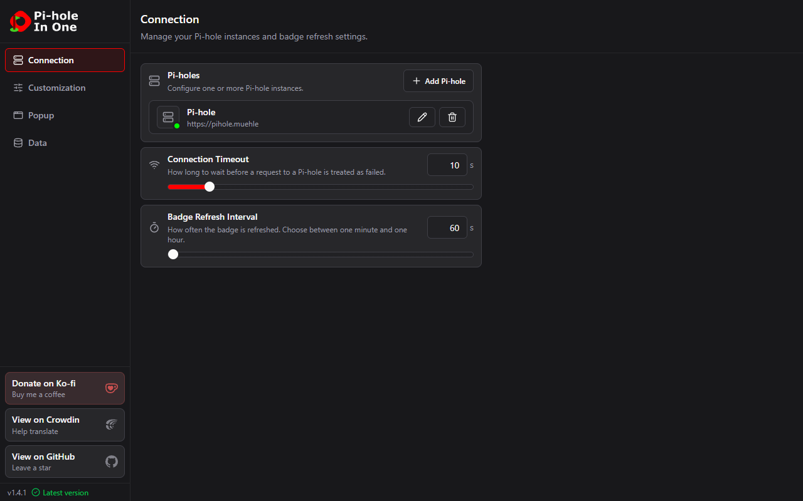
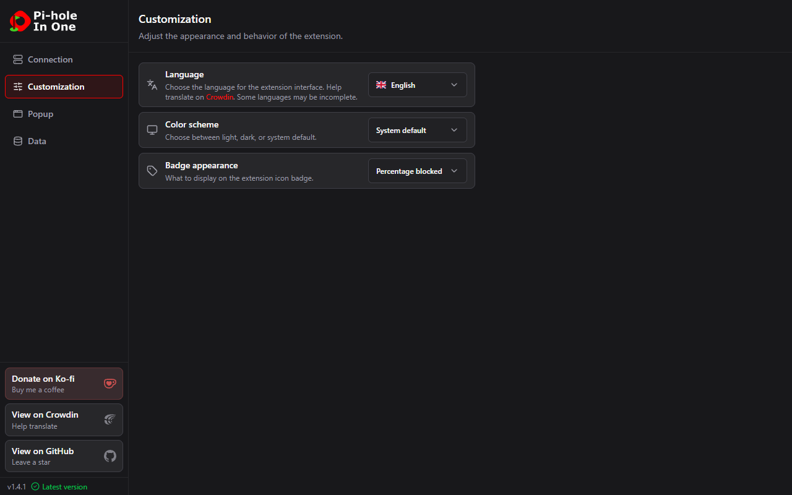
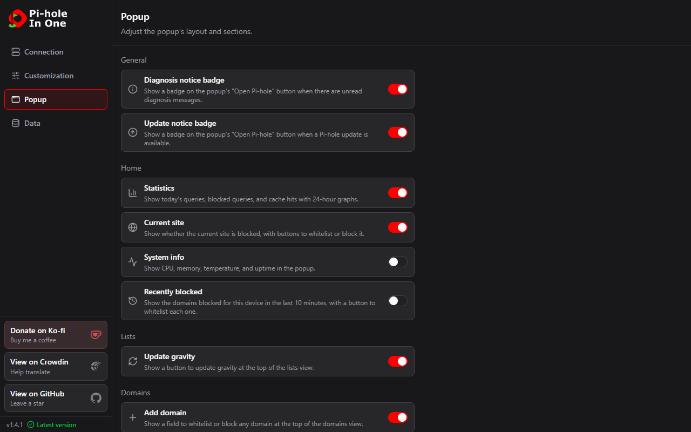
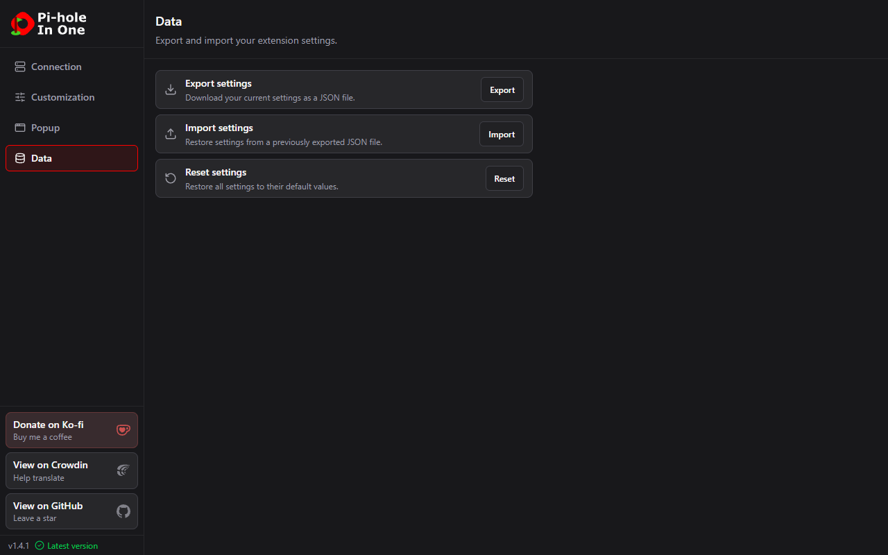

# 

A browser extension to control your Pi-hole conveniently from within the browser.

[](https://github.com/creeperkatze/pihole-js)


[](https://crowdin.com/project/pihole-in-one)


[❓ FAQ](https://pihole-in-one.creeperkatze.dev/faq) •
[📝 Changelog](https://github.com/creeperkatze/pihole-in-one/releases) •
[💬 Discord](https://link.creeperkatze.dev/discord)

[](https://ko-fi.com/creeperkatze)

> [!NOTE]
> The extension is not associated with or endorsed by Pi-hole.

## 🚀 Installation

Install from your browser's extension store:

- **[Chrome Web Store](https://chromewebstore.google.com/detail/pi-hole-in-one/gaaobidjebianpcngcfpkniaocibidhe)** 
- **[Firefox Add-Ons](https://addons.mozilla.org/firefox/addon/pihole-in-one/)** 
- **[Edge Add-Ons](https://microsoftedge.microsoft.com/addons/detail/pihole-in-one/hbigjlhijpiegpnbdhmdgdlfbcgljdao)** 

Prefer to build from source? See [🔒 Building from source](#-building-from-source) below.

## ⚙️ Setup

1. Open the extension settings.
2. Under **Connection**, click **Add Pi-hole**.
3. Enter your Pi-hole's address (e.g. `pi.hole` or `192.168.1.2`) and your **password** (your admin password, or an app password from Settings > API). Leave the password empty if your Pi-hole has none.
4. Optionally give it a name and an icon, then click **Save** and allow access to your Pi-hole when the browser asks.
5. The dot next to your Pi-hole turns green once it's connected.

> [!TIP]
> If your Pi-hole uses HTTPS with its own certificate, your browser has to trust that certificate first. See the [Pi-hole TLS documentation](https://docs.pi-hole.net/api/tls/).

## ✨ Features

<table>
<tr>
<td width="50%"></td>
<td width="50%"><h3>Blocking control</h3>Turn blocking on or off with one click, or pause it for anywhere from 10 seconds to an hour and let it switch back on by itself.</td>
</tr>
<tr>
<td width="50%"><h3>Current site</h3>See at a glance whether the site you're on is blocked, and by which list, then allowlist or block it in one click.</td>
<td width="50%"></td>
</tr>
<tr>
<td width="50%"></td>
<td width="50%"><h3>Domains</h3>Allowlist or block any domain, or a whole pattern with regex, without opening the Pi-hole admin interface.</td>
</tr>
<tr>
<td width="50%"><h3>Groups and lists</h3>Switch groups and blocklists on or off, and update gravity right after.</td>
<td width="50%"></td>
</tr>
<tr>
<td width="50%"></td>
<td width="50%"><h3>Multiple Pi-holes</h3>Manage every Pi-hole you run, give each its own icon, and switch between them with one click.</td>
</tr>
<tr>
<td width="50%"><h3>Toolbar badge</h3>Show the block rate, blocking status, or number of active clients right on the extension icon.</td>
<td width="50%"></td>
</tr>
<tr>
<td width="50%"></td>
<td width="50%"><h3>Your popup, your way</h3>Choose which cards the popup shows, pick your language, and go light or dark.</td>
</tr>
<tr>
<td width="50%"><h3>Settings backup</h3>Export your settings, import them in another browser, or start over with the defaults.</td>
<td width="50%"></td>
</tr>
</table>

## 🔒 Building from source

If you don't want to trust the store release, you can build the extension yourself directly from the source code.

**Prerequisites:** [Node.js](https://nodejs.org) and [pnpm](https://pnpm.io)

```bash
# Clone the repository
git clone https://github.com/creeperkatze/pihole-in-one.git
cd pihole-in-one

pnpm install

# Chrome / Edge
pnpm zip

# Firefox
pnpm zip:firefox
```

The resulting zips are placed in `.output/`.

To install the extension manually:

- **Chrome / Edge:** go to `chrome://extensions/`, enable **Developer mode**, then drag and drop the zip onto the page.
- **Firefox:** go to `about:debugging#/runtime/this-firefox`, click **Load Temporary Add-on**, and select the zip. Note that Firefox removes the extension on browser restart since it is loaded as a temporary add-on.

## 👨‍💻 Development

### Setup

```bash
git clone https://github.com/creeperkatze/pihole-in-one.git
cd pihole-in-one

pnpm install
```

### Running

```bash
pnpm dev
```

## 🌐 Translating

Translations are managed on [Crowdin](https://crowdin.com/project/pihole-in-one). You can contribute without any technical knowledge, just pick your language and start translating.

New translations are automatically pulled every Monday.

## 🤝 Contributing

Contributions are always welcome!

Please ensure you run `pnpm lint:fix` and `pnpm fmt` before opening a pull request.

## 📜 License

AGPL-3.0
